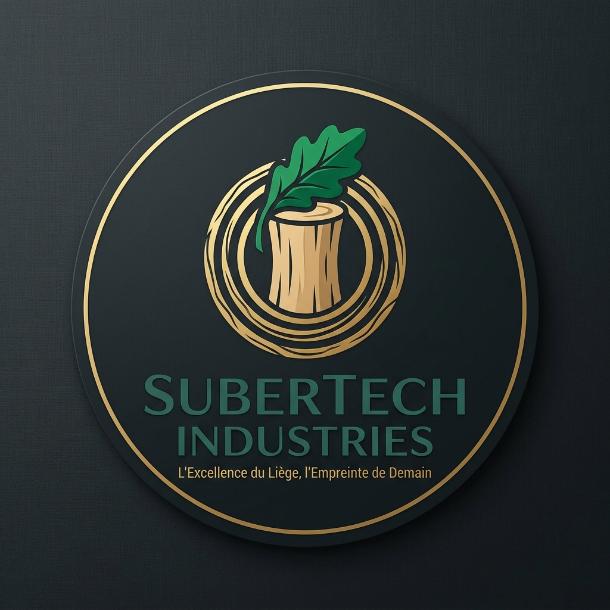

# ÉQUIPE [X] - IDENTITÉ DE MARQUE & STRATÉGIE INDUSTRIELLE
**Simulation Pédagogique VINEGO (Sciado Partenaires) - Promotion Ingénieurs 2026**

---

## 1. Identité Visuelle Officielle

* **Nom de l'entreprise :** **SuberTech Industries**
* **Slogan officiel :** *« L'Excellence du Liège, l'Empreinte de Demain »*
* **Fichiers livrables :** `logo.jpg` (Haute Définition pour impression/Word) et `logo.svg` (vectoriel haute précision).

---

## 2. Genèse & Signification du Nom et du Logo

### A. L'Étymologie : *SuberTech*
* **Suber (du latin *Quercus Suber*) :** Fait référence directe au chêne-liège, arbre emblématique du bassin méditerranéen dont l'écorce possède la capacité unique de se régénérer sans abattre l'arbre. C'est l'essence même de la durabilité et de la noblesse viticole.
* **Tech (pour Technologie Industrielle) :** Représente notre savoir-faire de pointe dans la trituration fine (granulés calibrés de 0,5 mm à 2 mm), la sélection homogène des matières et le moulage sous haute précision garantissant une élasticité et une neutralité organoleptique absolue pour les vins.

### B. Le Symbolisme Graphique
* **L'anneau technologique & l'écorce :** Symbolisent la maîtrise du cycle de fabrication, de la forêt espagnole jusqu'au bouchage des bouteilles.
* **La feuille d'émeraude :** Incarne notre engagement éco-responsable (zéro déchet, empreinte carbone réduite, valorisation des sous-produits).
* **Les teintes Or & Liège :** Évoquent le prestige du vin, la qualité des finitions et la valeur ajoutée créée pour nos distributeurs partenaires.

---

## 3. Le Slogan : Analyse Stratégique

> ### *« L'Excellence du Liège, l'Empreinte de Demain »*

Ce slogan formalise notre double proposition de valeur :
1. **L'Excellence du Liège :**
   * Neutralité sensorielle garantie pour préserver les arômes délicats des domaines vignerons et des caves coopératives.
   * Maîtrise rigoureuse des tolérances de production pour assurer une parfaite régularité aux lignes d'embouteillage des distributeurs et grands comptes.
2. **L'Empreinte de Demain :**
   * **Empreinte carbone minimale :** Priorité donnée au transport ferroviaire (Train) et maritime (Bateau) pour réduire les émissions de GES de plus de 60% par rapport à une logistique routière classique, et exclusion totale du fret aérien.
   * **Empreinte sociétale positive :** Partenariats transparents et pérennes avec les 4 distributeurs, politique de prix juste et traçabilité forestière intégrale.

---

## 4. Stratégie Industrielle & Commerciale

Notre vision d'ingénieurs industriels repose sur un modèle d'excellence opérationnelle :

1. **Optimisation des Rendements Matière :**
   * Rendement de broyage stabilisé à 35% avec valorisation énergétique des résidus fins.
   * Rendement de moulage calibré à 0,20 lot/kg (soit exactement 5 kg de granulés par lot de bouchons agglomérés).
   * Coût direct de production maîtrisé à **9,00 € / lot** grâce à des approvisionnements groupés auprès du producteur (> 70 000 kg).

2. **Politique Commerciale Partenariale :**
   * **Sécurisation de la demande historique :** Traitement prioritaire des commandes de notre client allemand **STECKER**.
   * **Accompagnement ciblé des distributeurs :** Offres adaptées aux débouchés à forte valeur ajoutée (Vignerons @ 40-80 € et Caves @ 25-50 €), permettant aux distributeurs de dégager jusqu'à 60% de marge brute tout en préservant notre rentabilité.
   * **Compétitivité volume :** Capacité à approvisionner les Grands Comptes à prix compétitifs (21,00 € - 21,50 €) grâce à notre absorption optimale des charges fixes (seuil de rentabilité franchi dès 9 474 lots).

---

## 5. Charte Éthique & Engagements RSE

En tant qu'industriel responsable, **SuberTech Industries** s'engage sur 5 principes cardinaux :

| Axe RSE | Engagement Concret SuberTech Industries |
| :--- | :--- |
| **1. Approvisionnement Responsable** | 100% de notre liège brut provient d'exploitations certifiées garantissant le repos biologique des arbres (cycle d'écorçage de 9 ans minimum). |
| **2. Logistique Bas-Carbone** | Politique de transport multimodal favorisant le rail et le transport maritime à plein chargement. Bannissement formel de l'avion. |
| **3. Zéro Déchet de Broyage** | 100% des chutes de tubage et des poussières de liège non utilisées dans les bouchons sont réinjectées ou valorisées comme biomasse thermique. |
| **4. Équité & Transparence Commerciale** | Respect scrupuleux des délais de paiement, clarté des bordereaux de livraison et refus de toute pratique de dumping déloyale envers les pairs industriels. |
| **5. Santé & Sécurité Industrielle** | Ergonomie des postes de travail autour des broyeurs et mouleuses, filtration avancée des particules en suspension dans les ateliers. |

---

*Document produit par l'Équipe SuberTech Industries dans le cadre du Challenge Identité du Mois 1.*
